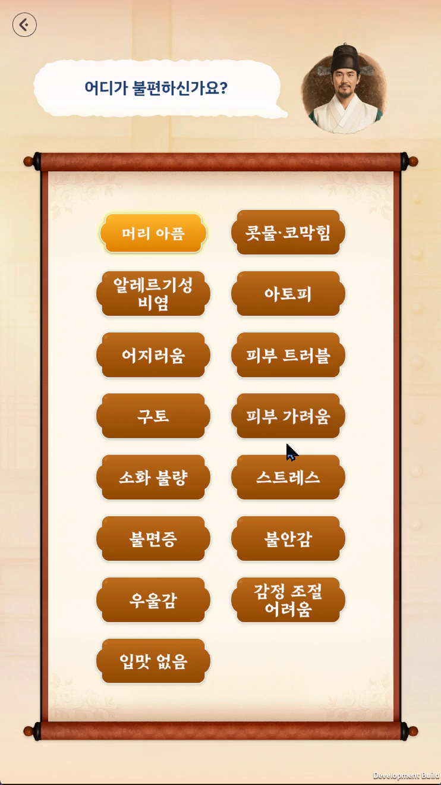

# mediapipeDoc

> **2025 국립과천과학관 전시** · [프로젝트 페이지](https://wri0raan.github.io/JURAN/projects/acupoint.html)

웹캠 포즈 추정 결과를 기반으로 증상별 혈자리 위치를 사용자 신체 위에 실시간 오버레이하는 세로형 키오스크 애플리케이션입니다.
증상 선택 → 포즈 인식 → 혈자리 표시 → 지압법 영상 안내로 이어지는 흐름을 구현했습니다.


## Overview

| 항목 | 내용 |
|---|---|
| 분야 | Vision-based Healthcare Interface, Kiosk Application |
| 엔진 | Unity 6 (6000.0.59f2), C# |
| 비전 | MediaPipe Unity Plugin — Pose Landmarker |
| 해상도 | 1080 × 1920 (세로형) |

## Application Flow

```
메인 화면 ─▶ 증상 선택 (14종) ─▶ 카메라 초기화 / 로딩
        ─▶ 포즈 기반 혈자리 오버레이 ─▶ 지압법 영상 · 참고 문헌 · QR
        ─▶ 무입력 타임아웃 시 메인 화면 복귀
```

## Key Features

- **혈자리 오버레이**: 포즈 랜드마크 중 기준점(예: 안면 랜드마크)을 이용해 마커 위치 산출, 화면 비율·좌우 반전 보정 및 픽셀 오프셋 적용
- **증상별 콘텐츠 구성**: 두통, 비염, 어지러움, 피부 트러블, 소화 불량, 불면, 우울감 등 14개 증상
- **영상 플레이어**: 재생·일시정지·재개 제어 및 팝업 재생
- **UI 트랜지션**: 화면별 인트로 시퀀스, 버튼 호버 처리
- **키오스크 운영 기능**
  - 60초 무입력 시 메인 화면 복귀
  - 결과 화면 자동 초기화
  - 카메라 준비 대기 및 실패 처리
  - 창 크기·해상도 고정

## Scripts

| 파일 | 역할 |
|---|---|
| `Scripts/CheckBodyFlow.cs` | 카메라 준비 → 로딩 → 오버레이 → 결과 상태 흐름 |
| `Resources/Script_/PosePointDrawer_Preset1.cs`, `Preset2.cs` | 랜드마크 기반 혈자리 마커 배치 |
| `Resources/Script_/InactivityManager.cs` | 무입력 타임아웃 처리 |
| `Resources/Script_Video/*` | 영상 재생 제어 |
| `Resources/Script_Animation/*` | UI 트랜지션 |
| `Resources/Script_MoveScene/*`, `Scripts/Main/*` | 증상 선택 및 씬 전환 |
| `Scripts/Main/WindowSizeKeeper.cs`, `Resources/Script_/ForceResolution*.cs` | 해상도·창 크기 고정 |
| `Scripts/SafeWebcamBoot.cs` | 웹캠 초기화 |

## Repository Structure

```
Scripts/   직접 작성한 C# 스크립트 (MediaPipe 플러그인 코드 제외)
media/     스크린샷, 미리보기 GIF
```

> 개인정보 보호를 위해 카메라 영상이 포함되는 오버레이 단계는 스크린샷에서 제외했습니다.

## Screenshots

| 메인 화면 | 안내 화면 | 증상 선택 |
|---|---|---|
|  |  |  |
